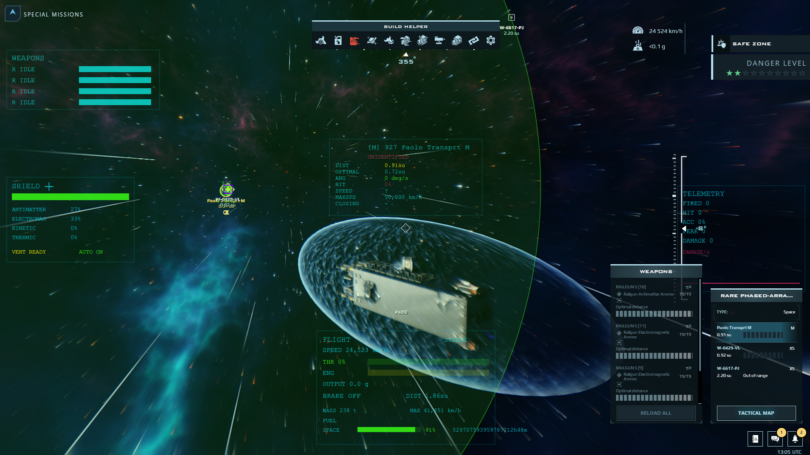

# DU Paolo Combat HUD

A pair of cooperating **PvP HUDs for [Dual Universe](https://www.dualuniverse.game/)** — one for the **gunner seat** and one for the **remote controller / pilot** — sharing a common databank so the gunner and pilot see one coordinated picture. Built in a *retrosyncwave* neon style.



> **⬇ Download:** [**DU-Paolo-Combat-HUD-v28.zip**](https://github.com/pa0l0s/DU-Paolo-Combat-HUD/raw/master/dist/DU-Paolo-Combat-HUD-v28.zip) — contains both `.conf` files + a quick-install note.

---

## What you get

Two autoconfigure (`.conf`) scripts that you apply to two different elements on your ship:

| File | Apply to | Role |
|------|----------|------|
| `gunner_seat_hud.conf` | **Gunner seat** / command seat | Targeting, weapons, radar, damage telemetry |
| `remote_controller_hud.conf` | **Remote controller** | Flight, brakes, shield, **fuel**, aim assist |

They talk to each other through a **shared databank**, so the two crew positions cooperate instead of fighting for the same screen.

---

## Feature tour

The screenshot above shows both HUDs on one ship. Here is what each part does.

### 🔫 Gunner seat HUD
- **WEAPONS panel** (top-left) — every weapon on one readout: state (`IDLE` / `RELOAD` / `FIRING`) and reload/heat bars.
- **Target panel** (center) — locked-target intel: distance, optimal range, angular speed, hit-chance %, target speed, max speed, closing rate.
- **AR markers** — a marker painted on the world over each tracked contact, tinted by threat.
- **Forward crosshair + firing cone** — a small crosshair pointing along the ship's forward axis, wrapped by a half-transparent circle showing your guns' actual **aiming cone** (with your skill/talent modifiers applied), so you know when a target is inside your firing envelope.
- **TELEMETRY panel** (right) — shots fired, hits, accuracy %, damage dealt, and a live **DAMAGE/s chart**.

### 🚀 Remote controller HUD
- **FLIGHT panel** (bottom-center):
  - **SPEED**, **MASS**, **MAX** speed
  - **THR** — commanded throttle % + bar
  - **ENG** — actual engine output (shows the warm-up ramp as engines spool toward the set throttle)
  - **OUTPUT** — current acceleration in *g*
  - **BRAKE** — brake state + always-on **brake distance**
  - **STABLE / SMOOTH** — current rotation mode (top-right of the panel)
  - **FUEL** — one row per fuel type carried (see below)
- **SHIELD panel** (left) — shield HP bar, per-type resistances (Antimatter / Electromag / Kinetic / Thermic), vent status, and **auto-resist** state.
- **Move-direction marker** — a small ring showing where the ship is actually heading (prograde), separate from where the nose points.
- **Warnings** — a red `! BRAKE + THROTTLE !` alert (with a sound) when you brake while the throttle still commands thrust, and `! LOW FUEL !` when any tank runs low.

### ⛽ Fuel readout (auto-detected)
- Shows a row for **each fuel type you actually carry** — Atmo, Space, and/or Rocket. Types you don't have are hidden.
- Per type: **fill % + bar** and **estimated burn time** (the game's own precise value, so it already reflects current consumption). Across multiple tanks it shows the **worst-case** (soonest-empty) time.
- **No linking required** — fuel tanks bind automatically, exactly like the native fuel widget. One tank or twenty, it just works.
- Turns **red + `! LOW FUEL !`** (and chimes once) when a type drops below your thresholds — see [Configuration](#configuration).

---

## Installation

**Quick version:**

1. Download and unzip [**DU-Paolo-Combat-HUD-v28.zip**](https://github.com/pa0l0s/DU-Paolo-Combat-HUD/raw/master/dist/DU-Paolo-Combat-HUD-v28.zip).
2. Copy both `.conf` files into your Dual Universe **custom autoconf** folder:
   ```
   %ProgramData%\Dual Universe\Game\data\lua\autoconf\custom\
   ```
   (or `<your DU install>\Game\data\lua\autoconf\custom\`)
3. In game, right-click the element → **Advanced → Update custom autoconf** → pick the HUD.
   The version (`v28`) is shown in the config name so you can confirm the new one loaded.

**Full step-by-step, including what to link:** see **[INSTALL.md](INSTALL.md)**.

### What to connect

| Element | Link to it |
|---------|-----------|
| **Gunner seat** | your Weapons, a **PVP Radar**, and a **Databank** |
| **Remote controller** | a **Shield generator** and the **same Databank** |
| **Fuel tanks** | *nothing* — they bind automatically |

> Use **one shared databank** linked to *both* control units so the gunner and pilot HUDs stay in sync.

---

## Controls (remote controller)

Applying the controller `.conf` replaces the unit's flight Lua, so flight is driven by the HUD. It follows Dual Universe's **standard flight keybinds** (rebindable in *Settings → Keybindings*):

| Input | Action |
|-------|--------|
| **W / S / A / D** | Rotate the ship (pitch + roll) |
| **Q / E** | Yaw |
| **Mouse wheel** | Throttle up / down |
| **Left Ctrl** (Brake) | Toggle brakes on/off *(configurable to momentary hold — see `brakeToggle`)* |
| **Space** | Toggle **SMOOTH ⇄ STABLE** rotation mode |
| **Stop engines** key | Cut throttle to 0 |
| **Option 6** | Toggle shield **auto-resist** |
| **Option 8** | Toggle shield **venting** |

- **STABLE** — rotation auto-damps when you release the keys (steady flying).
- **SMOOTH** — the ship holds its spin and your keys gently *nudge* it, for fine aiming. Sensitivity is deliberately gentle; tune with `smoothTorque`.

---

## Configuration

Every tunable is a Dual Universe **`--export`** on the control unit. Edit them in-game via right-click → **Advanced → Edit Lua parameters** — no rebuild needed.

### Remote controller exports

| Export | Default | Meaning |
|--------|--------:|---------|
| `rotationSpeed` | `0.5` | STABLE-mode max rotation rate (rad/s). Lower = less sensitive. |
| `torqueFactor` | `1` | STABLE-mode responsiveness/damping. Higher = snappier, less stable. |
| `smoothTorque` | `0.04` | SMOOTH-mode input strength. Low = gentle fine-aim nudges. |
| `brakeToggle` | `true` | Brake key **toggles** on/off (`true`) or is momentary **hold** (`false`). |
| `brakeSpeedFactor` | `3` | Brake force that scales with velocity. |
| `brakeFlatFactor` | `1` | Flat brake force — brings the ship fully to a stop. |
| `fuelLowLevel` | `20` | Low-fuel warning when a fuel type drops below this **%**. |
| `fuelLowTime` | `120` | Low-fuel warning when estimated burn time drops below this many **seconds**. |
| `warnSound` | `warning.mp3` | Sound played on brake-with-throttle / low-fuel. Put the file in `NQ/DualUniverse/audio`. |

> **Sound:** the alert sound only plays if `warnSound` names a file present in your DU audio folder (`…/NQ/DualUniverse/audio`). If you don't have one, the visual warnings still work.

---

## Build from source

The HUDs are written as small, testable Lua modules (SOLID layering: pure `core/`, render `render/`, thin DU adapters `du/`) and bundled into the `.conf` files by a PowerShell build script.

```powershell
cd PVPHud
lua tests/run.lua      # run the unit tests (249 passing)
.\build.ps1            # bundle src/ -> the two .conf files, bump build no., deploy
```

- `PVPHud/src/` — the modules (no DU globals in `core/`).
- `PVPHud/tests/` — desktop Lua tests with stubbed DU globals.
- `PVPHud/build.ps1` — the bundler + conf generator. **Never hand-edit the generated `.conf` files** — edit `src/` and rebuild.
- `dist/` — packaged release zips.

---

## Credits

Flight, brake, and fuel behavior were reverse-engineered from, and validated against, the community reference HUDs (paolo's minimal flight HUD, GFL_Pilot, FOX_Flight, ArchHUD) and the official DU API mockups. Retrosyncwave neon styling throughout.
